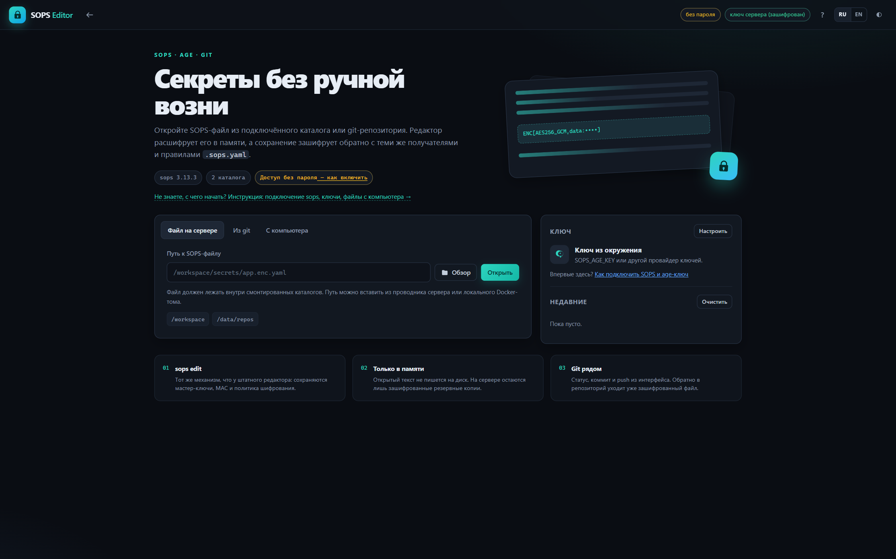
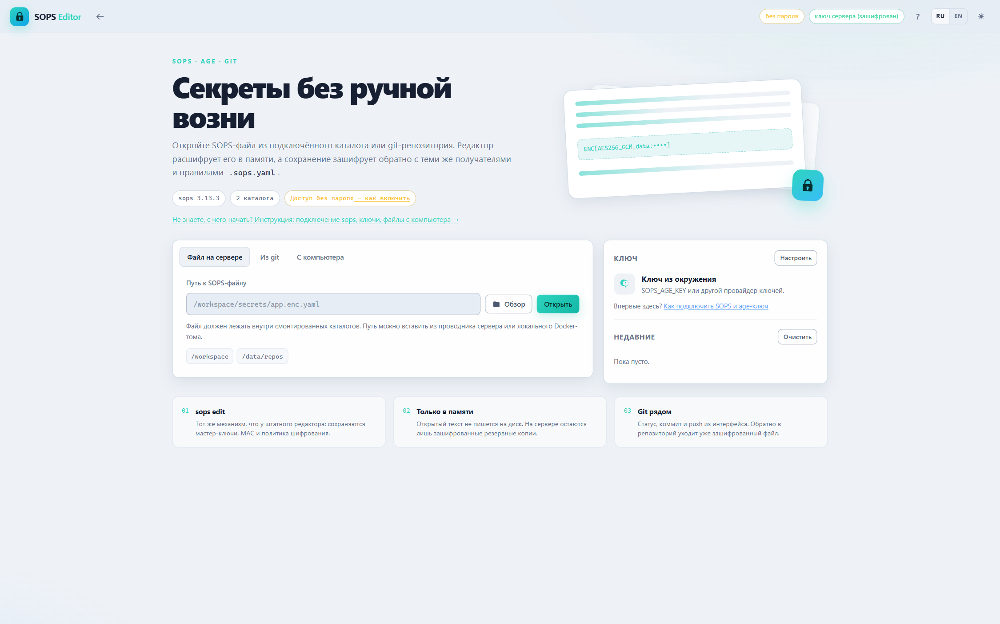
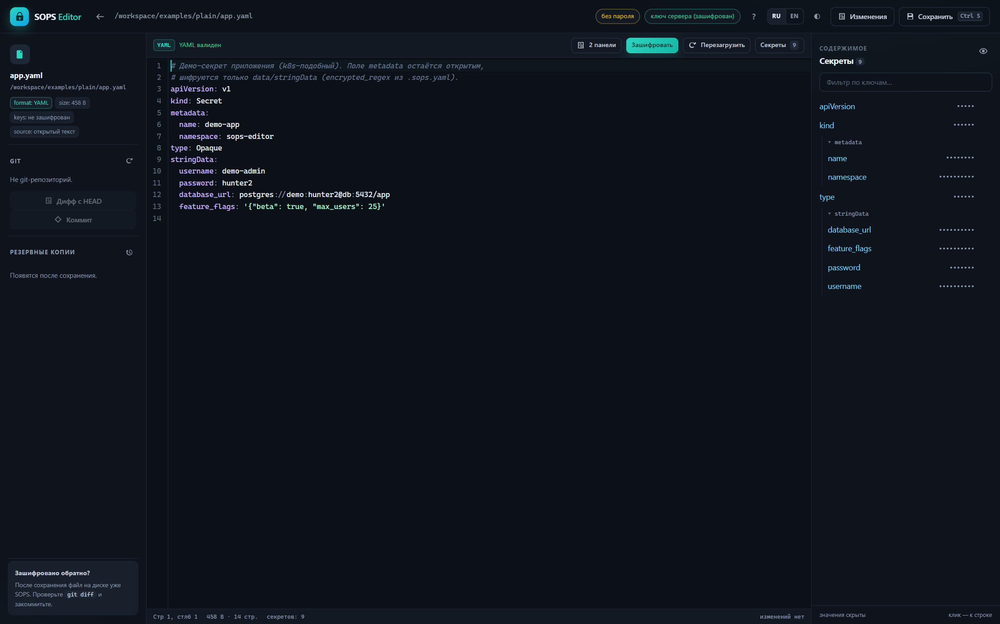
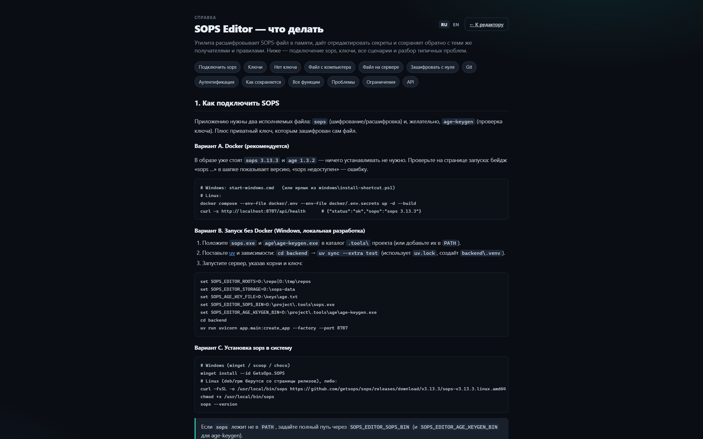
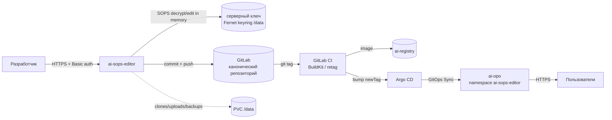

<div align="center">


<h1>SOPS Editor</h1>

Веб-редактор секретов, зашифрованных <a href="https://getsops.io/">SOPS</a>.<br>
Файл из git-чекаута, склонированного репозитория или с вашего компьютера расшифровывается **в памяти**, редактируется в настоящем редакторе и сохраняется обратно **зашифрованным** — с теми же получателями и правилами `.sops.yaml`.

<a href="LICENSE"></a>


<sub>Русская версия · <a href="docs/ru/DEPLOY.md">Деплой</a> · <a href="docs/ru/SECURITY.md">Безопасность</a></sub>

</div>

---

| Тёмная тема | Светлая тема |
|---|---|
|  |  |
|  |  |

## Содержание

- [Ключевые возможности](#ключевые-возможности)
- [Как это работает](#как-это-работает)
- [Быстрый старт](#быстрый-старт)
- [Примеры файлов](#примеры-файлов)
- [Файлы с компьютера](#файлы-с-компьютера)
- [Ключи](#ключи)
- [Как устроено сохранение](#как-устроено-сохранение)
- [Git](#git)
- [Деплой: Docker и NeuroAI k8s](#деплой-docker-и-neuroai-k8s)
- [Настройки](#настройки)
- [HTTP API](#http-api)
- [Разработка и тесты](#разработка-и-тесты)
- [Структура проекта](#структура-проекта)
- [Планы](#планы)
- [Лицензия](#лицензия)

## Ключевые возможности

| | |
|---|---|
| **Сохранение через SOPS** | Запись идёт через `sops edit`: мастер-ключи, MAC, `encrypted_regex` и остальные правила **исходного** файла сохраняются. Инструмент не пересобирает файл «с другими получателями». |
| **Открытый текст только в памяти** | Расшифровка — в процессе сервера и браузера. Резервные копии и загрузки — шифротекст; временный payload для `sops edit` — файл `0600` в каталоге `0700`, удаляется в `finally`. |
| **Проверяемая запись** | Перед сохранением SHA-256 сравнивается с тем, что видел браузер (защита от перезаписи чужой правки). После — файл расшифровывается снова и сверяется с отправленным; при ошибке оригинал восстанавливается. |
| **Обычные файлы тоже** | Открытый YAML / JSON / dotenv / INI открывается без ключа, кнопка **«Зашифровать»** создаёт SOPS-версию — по `.sops.yaml`, явному age-получателю или серверному ключу. |
| **Настоящий редактор** | CodeMirror с подсветкой YAML/JSON, поиском, сворачиванием, `Ctrl+S`, валидацией синтаксиса и деревом секретов с переходом по строке. |
| **Ключи — четыре способа** | Зашифрованное серверное хранилище (обновление без чтения), файл на сервере, переменные `SOPS_AGE_KEY`/`SOPS_AGE_KEY_FILE` или ключ, вставленный в UI (только в памяти процесса, TTL 8 ч, привязан к cookie вкладки). Нет ключа? Диалог покажет получателей из метаданных файла. |
| **Панель изменений** | Переключатель в тулбаре делит редактор: вторая панель показывает только изменённые участки (старые строки красным, новые зелёным, по 3 строки контекста) и обновляется по мере ввода и прокрутки. Отдельное окно сравнивает файл с `HEAD` — расшифрованно и рядом. |
| **Видимый прогресс** | Открытие, загрузка и сохранение показывают реальные фазы (проверка пути, метаданные SOPS, `sops decrypt`, формат, git) и таймер, а не «вечный» спиннер. |
| **Git внутри** | Статус ветки и файла, коммит только текущего файла, push, `pull --ff-only`, клонирование по HTTPS или SSH в `/data/repos`; необязательная папка — sparse checkout только её. |
| **Два языка** | Переключатель RU/EN в шапке; справка следует за языком и темой. |
| **Один контейнер** | FastAPI отдаёт API и статический интерфейс. Без nginx, без сборки, без Node на сервере. |

## Как это работает



Приватный ключ не попадает в браузер: он отправляет путь или шифротекст, сервер
расшифровывает его через `sops`, а открытый текст идёт только по аутентифицированному
HTTPS-соединению в одну вкладку. GitLab — единственный источник истины; деплой
запускается тегом и Argo CD.

## Быстрый старт

### Windows (Docker Desktop)

1. Установите и запустите Docker Desktop.
2. Запустите `start-windows.cmd` — скрипт спросит каталог с SOPS-файлами, соберёт
   образ и откроет `http://localhost:8787`. Ярлык создаётся
   `windows\install-shortcut.ps1`.
3. При необходимости положите age-ключ в `keys/age.txt` или вставьте его в UI позже.
   Остановка — `stop-windows.cmd`.

### Linux / macOS (Docker Compose)

```bash
git clone git@gitlab.vitebsk.energo.net:opo/neuro-ai/ai-sops-editor.git
cd ai-sops-editor
cp docker/.env.example docker/.env
cp docker/.env.secrets.example docker/.env.secrets
# docker/.env: SOPS_EDITOR_WORKSPACE=/path/to/repo
docker compose --env-file docker/.env --env-file docker/.env.secrets up -d --build
# http://localhost:8787
```

Каталог хоста монтируется как `/workspace`; пути в интерфейсе — контейнерные,
например `/workspace/secrets/app.enc.yaml`.

> По умолчанию порт слушает только `127.0.0.1`, Basic auth выключен. Это допустимо
> только на localhost — для сервера см. [деплой](docs/ru/DEPLOY.md).

<details>
<summary>Если <code>docker compose … up --build</code> падает с <code>failed to execute bake</code></summary>

Часть сборок Compose не умеет Bake. Соберите образ напрямую и запустите:

```bash
docker build -t ai-sops-editor:local .
docker compose --env-file docker/.env --env-file docker/.env.secrets up -d
```

В `start-windows.cmd` этот fallback уже есть.
</details>

## Примеры файлов

В репозитории есть готовые примеры: Kubernetes-секрет, вложенный YAML, JSON, dotenv
и INI, плюс открытые двойники для сценария «зашифровать с нуля».

```bash
cp keys/age.example.txt keys/age.txt     # демо-ключ; Windows: copy keys\age.example.txt keys\age.txt
```

Откройте `/workspace/examples/secrets/app.enc.yaml` во вкладке **«Файл на сервере»**
или загрузите `workspace/examples/plain/config.json` во вкладке **«С компьютера»** и
нажмите **«Зашифровать»**.

> `keys/age.example.txt` — публичный демо-ключ, он защищает только примеры.
> Никогда не используйте его для настоящих секретов.

## Файлы с компьютера

1. Вкладка **«С компьютера»** → **«Выбрать файл»** или перетащите файл в зону.
   Chrome/Edge запоминает файл через File System Access API; остальные браузеры
   используют обычный диалог. Открытый YAML/JSON/dotenv/INI тоже открывается.
2. Нет серверного ключа? Появится окно **«Ключ»** — вставьте `AGE-SECRET-KEY-1…`;
   ключ остаётся в памяти процесса, файл откроется сразу.
3. Правьте и нажимайте **«Сохранить»** — сервер зашифрует файл и сразу перезапишет
   исходный локальный файл. Если браузер не дал права на запись, файл скачается.
4. Кнопка **«Скачать»** в верхней панели доступна для любого файла. Если локальный
   файл лежит в git-репозитории, закоммитьте его своим `git` после перезаписи; для
   коммита/push из интерфейса используйте смонтированный `/workspace`.

> Браузер не отдаёт полный локальный путь. Инструмент работает с выбранным файлом;
> для работы с целым репозиторием смонтируйте его как `/workspace`.

## Ключи

| Источник | Как задать | Примечания |
|---|---|---|
| Файл на сервере | `keys/age.txt` → `/keys/age.txt` | `chmod 600`, владелец — пользователь контейнера (по умолчанию root) |
| Переменные | `SOPS_AGE_KEY` / `SOPS_AGE_KEY_FILE` | PGP/KMS используют свои переменные и креды |
| Сессия UI | Кнопка **«Ключ»** → вставить `AGE-SECRET-KEY-1…` | память процесса, TTL 8 ч, привязан к cookie вкладки |
| Серверное хранилище | **«Ключ»** → «Серверный ключ» → вставить и обновить | хранится зашифрованным в `/data/server-key`; прочитать через UI нельзя |

Серверное хранилище включается мастер-ключом `SOPS_EDITOR_KEYSTORE_KEY`
(Fernet; генерируется командой `python -c "from cryptography.fernet import Fernet; print(Fernet.generate_key().decode())"`).
Мастер-ключ не входит в образ и не должен коммититься — храните его в Docker/K8s
secret. UI отдаёт только публичных получателей и отпечаток; endpoint для чтения
приватного ключа отсутствует. Ключ не «зашивается» в исходники или образ: иначе
он неизбежно утечёт вместе с репозиторием/слоем образа.

```bash
age-keygen -o age.txt
grep 'public key' age.txt   # этого получателя добавьте в .sops.yaml
```

Получатель должен уже быть в `.sops.yaml` репозитория: инструмент не меняет
получателей. Без подходящего приватного ключа расшифровка невозможна — диалог
показывает получателей из файла, а в справке есть раздел «Нет ключа».

## Как устроено сохранение

1. Сервер читает актуальный шифротекст и сравнивает SHA-256 с тем, что видел браузер
   (защита от перезаписи параллельной правки).
2. Делает резервную копию шифротекста в `/data/backups/<hash>/`.
3. Записывает присланный открытый текст в файл `0600` в приватном каталоге `0700`.
4. Запускает `sops edit <файл>`: SOPS расшифровывает оригинал, вызывает одноразовый
   «редактор», шифрует обратно **с исходными метаданными** и обновляет MAC/`lastmodified`.
5. Расшифровывает результат и сверяет данные с присланными; при ошибке оригинал
   восстанавливается атомарно.
6. Удаляет временный открытый текст в `finally`.

В любой момент на диске лежит либо старый, либо новый шифротекст.

## Git

- **Коммит** — `git add -- <файл>` + `git commit -- <файл>`; только текущий файл.
  Автор и committer — имя/email из полей коммита (предзаполняются из host
  `~/.gitconfig`, смонтированного в `/gitconfig`). Email должен совпадать с
  подтверждённым email в GitLab, иначе коммит не привяжется к пользователю.
  В сообщение автоматически добавляется трейлер `Made-with: SOPS Editor`.
- **Push** — `git push`; для HTTPS задайте `SOPS_EDITOR_GIT_TOKEN` (GitLab `oauth2`),
  для SSH смонтируйте ключ/agent.
- **SSH** — host `~/.ssh` монтируется read-only в `/ssh`; приватный ключ
  (`id_ed25519`/`id_ecdsa`/`id_rsa`) копируется в `0600` на время операции.
  Поддерживаются `git@host:group/repo.git` и `ssh://git@host:port/...`.
  Для `ssh-agent` пробросьте `SSH_AUTH_SOCK`; для GitLab лучше отдельный deploy key.
  `start-windows.cmd` сам подставляет `%USERPROFILE%\.ssh`, если переменная не задана.
- **Клон** — URL + ветка + необязательная **папка** в `/data/repos/<name>`.
  HTTPS-токен задаётся только на сервере (`SOPS_EDITOR_GIT_TOKEN`). С папкой
  используется partial clone + sparse checkout: скачивается только она и
  корневые файлы вроде `.sops.yaml`, а не весь репозиторий.
- **Pull** — только `--ff-only` и только при чистом worktree.

## Деплой: Docker и NeuroAI k8s

### Lab/work Compose за Traefik

```bash
cp docker/.env.example docker/.env
cp docker/.env.secrets.example docker/.env.secrets
# docker/.env:
#   SOPS_EDITOR_WORKSPACE=/srv/git/secrets
#   SOPS_EDITOR_FQDN=ai-sops-editor.vitebsk.energo.net
#   SOPS_EDITOR_TRUST_PROXY=true
#   SOPS_EDITOR_COOKIE_SECURE=true
# docker/.env.secrets:
#   SOPS_EDITOR_AUTH_PASSWORD=<длинный случайный пароль>

docker compose -f docker-compose.yml -f docker-compose.traefik.yml \
  --env-file docker/.env --env-file docker/.env.secrets up -d --build
```

Нужна внешняя сеть `traefik_proxy`. Подробности:
[docs/ru/DEPLOY.md](docs/ru/DEPLOY.md) · [docs/ru/SECURITY.md](docs/ru/SECURITY.md).

### Prod NeuroAI (k8s + GitOps)

- FQDN: `ai-sops-editor.vitebsk.energo.net`; lab/work — `ai-sops-editor-dev.vitebsk.energo.net`.
- Namespace / Argo Application: `ai-sops-editor`.
- Образ: `ai-registry.vitebsk.energo.net/ai-sops-editor/ai-sops-editor`.
- Манифесты: `infra/k8s`; разовый bootstrap — `infra/bootstrap/ai-sops-editor.yaml`.
- Секреты: SOPS `infra/k8s/ai-sops-editor-secret.enc.yaml` через KSOPS.
- PVC: `ai-sops-editor-data` → `/data`; одна реплика, `Recreate`.
- CI: `.gitlab-ci.yml`; **любой git tag** → decide → BuildKit/retag → bump `newTag` → Argo Sync.

```bash
git tag v0.1.0
git push origin v0.1.0
```

Порядок первого выката: [docs/DEPLOY-K8S-FIRST-RUN.md](docs/DEPLOY-K8S-FIRST-RUN.md).
Канон и отклонения: [docs/DEPLOY-STANDARD.md](docs/DEPLOY-STANDARD.md).

## Настройки

Все настройки — переменные окружения с префиксом `SOPS_EDITOR_` (плюс стандартные
`SOPS_AGE_KEY_FILE` / `SOPS_AGE_KEY`):

| Переменная | По умолчанию | Назначение |
|---|---|---|
| `SOPS_EDITOR_ROOTS` | `/workspace\|/data/repos` | разрешённые корни, `\|` или `os.pathsep` |
| `SOPS_EDITOR_STORAGE` | `/data` | бэкапы, загрузки, клоны, логи |
| `SOPS_AGE_KEY_FILE` | `/keys/age.txt` (если есть) | приватный age-ключ |
| `SOPS_EDITOR_AUTH_USER` / `_PASSWORD` | `sops` / пусто | HTTP Basic auth |
| `SOPS_EDITOR_AUTH_MODE` | `basic` | `basic` · `header` (OIDC-прокси) · `none` |
| `SOPS_EDITOR_AUTH_HEADER` | `X-Forwarded-User` | заголовок личности в режиме `header` |
| `SOPS_EDITOR_AUTH_TRUSTED_PROXIES` | пусто | список IP/CIDR, которым разрешено его ставить |
| `SOPS_EDITOR_MAX_FILE_BYTES` | `5242880` | лимит файла |
| `SOPS_EDITOR_BACKUP_KEEP` | `10` | копий на файл |
| `SOPS_EDITOR_SESSION_TTL_SECONDS` | `28800` | TTL ключа в UI |
| `SOPS_EDITOR_ALLOW_GIT_CLONE` | `true` | разрешить клонирование |
| `SOPS_EDITOR_GIT_ALLOWED_HOSTS` | пусто | allowlist хостов для клона |
| `SOPS_EDITOR_GIT_TOKEN` | пусто | HTTPS-токен git |
| `SOPS_EDITOR_HOST_SSH_DIR` | `./.ssh-host` | host-каталог `~/.ssh`, монтируется в `/ssh` |
| `SOPS_EDITOR_HOST_GITCONFIG` | `./.gitconfig-host` | host `~/.gitconfig` для предзаполнения автора |
| `SOPS_EDITOR_GIT_SSH_KEY` | пусто | явный ключ в контейнере; пусто = автопоиск |
| `SOPS_EDITOR_GIT_SSH_STRICT_HOST_KEY_CHECKING` | `accept-new` | `accept-new` · `yes` · `no` |
| `SOPS_EDITOR_KEYSTORE_KEY` | пусто | мастер-ключ Fernet для серверного хранилища |
| `SOPS_EDITOR_TRUST_PROXY` / `_COOKIE_SECURE` | `false` | за обратным прокси |
| `SOPS_EDITOR_LOG_LEVEL` | `INFO` | уровень loguru |

## HTTP API

| Метод | Путь | Назначение |
|---|---|---|
| GET | `/api/health` | здоровье, версия sops |
| GET | `/api/status` | корни, auth, источник ключа |
| GET | `/api/browse?path=` | листинг каталога |
| GET | `/api/search?q=&path=` | поиск файлов |
| GET | `/api/file?path=` | расшифровать и открыть (и обычные файлы) |
| POST | `/api/file` | зашифровать/сохранить |
| GET/POST | `/api/file/job?op=` | то же с идентификатором операции |
| GET | `/api/ops/{id}` | статус, события, результат операции |
| POST | `/api/upload?name=&op=` | загрузка с компьютера (raw body) |
| POST | `/api/encrypt/upload?name=&recipients=` | зашифровать загруженный файл |
| POST | `/api/encrypt` | зашифровать серверный файл |
| GET | `/api/download?path=` | скачать загруженный файл |
| GET | `/api/backups?path=` | список копий |
| GET | `/api/backups/{id}?path=` | скачать копию |
| POST / DELETE | `/api/session/key` | задать / забыть age-ключ вкладки |
| GET / PUT | `/api/server-key` | статус / обновить серверный ключ (только запись) |
| GET | `/api/git?path=` | git status |
| POST | `/api/git/commit` · `/push` · `/pull` · `/clone` | git-действия |
| GET | `/api/git/diff?path=&op=` | расшифрованный файл и его версия из `HEAD` |
| POST | `/api/keys/rotate` | ротация ключей `updatekeys` / `rotate` (`{path, mode}`) |

Встроенная справка следует языку приложения: `?lang=ru` или `?lang=en` на
`/help.html`.

## Разработка и тесты

Зависимости управляются через [uv](https://docs.astral.sh/uv/) и зафиксированы в
`backend/uv.lock`:

```bash
cd backend
uv sync --extra test        # создаёт backend/.venv по uv.lock
uv run pytest -q            # 49 тестов
uv run ruff check app tests
```

Тесты работают с настоящими `sops` и `age-keygen`. На Windows положите бинарники в
`.tools/` (`sops.exe`, `age/age-keygen.exe`) или добавьте их в `PATH`; в Docker-образе
они уже есть. Без бинарников такие тесты пропускаются.

Запуск без Docker:

```bash
cd backend
SOPS_EDITOR_ROOTS="D:/repo|D:/tmp/repos" SOPS_AGE_KEY_FILE="D:/keys/age.txt" \
  uv run uvicorn app.main:create_app --factory --port 8787
```

Фронтенд — статические файлы, сборки нет: правьте `frontend/*.js|css|html` и
обновляйте страницу.

## Структура проекта

```text
backend/app/        FastAPI: sops, файлы, git, сессии, безопасность
backend/tests/      pytest с настоящим sops
backend/uv.lock     зафиксированный набор зависимостей (uv)
frontend/           статический UI (CodeMirror рядом), help.html + help.en.html, i18n.js
docker/             примеры окружения
docker-compose*.yml локальный / Traefik / офлайн
start-windows.cmd   запуск на Windows
windows/            установщик ярлыка
docs/               деплой, безопасность, скриншоты (ru/ — русские версии)
infra/              Kustomize, SOPS Secret, Argo bootstrap
.gitlab-ci.yml      GitLab CI: tag → image → bump
README.md           русская версия — её показывает GitLab
```

## Планы

- [x] Открытые файлы и «зашифровать с нуля»
- [x] Реальный прогресс вместо буферизованного ответа
- [x] Интерфейс и документация RU/EN
- [x] Ротация ключей (`sops updatekeys` / `rotate`) из UI
- [x] Diff расшифрованных значений рядом с git-версией
- [x] Опциональный OIDC перед Basic auth (доверенный заголовок от прокси)

## Ограничения

- Не редактирует **бинарные** SOPS-файлы (только YAML / JSON / dotenv / INI).
- Нет управления получателями/KMS: политика берётся из файла и `.sops.yaml`;
  для ротации — `sops updatekeys` / `sops rotate`.
- Нет многопользовательской модели: Basic auth, один серверный ключ или ключи
  по сессиям.
- Сборка образа требует интернета (sops/age/pip); офлайн-сборка не входит.
- Браузер не может записать произвольный путь — только файл, дескриптор которого
  держит (Chrome/Edge), иначе скачивание.

## Участие

Issues и merge requests — в GitLab-проекте
[`opo/neuro-ai/ai-sops-editor`](https://gitlab.vitebsk.energo.net/opo/neuro-ai/ai-sops-editor).
Об уязвимостях сообщайте приватно согласно [SECURITY.md](SECURITY.md), не в
публичный issue.

## Лицензия

[MIT](LICENSE) © 2026 Dzmitry.
