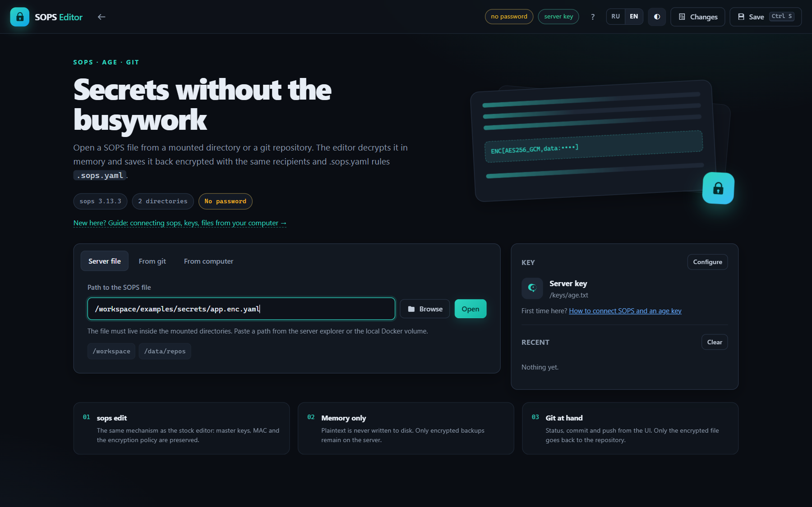
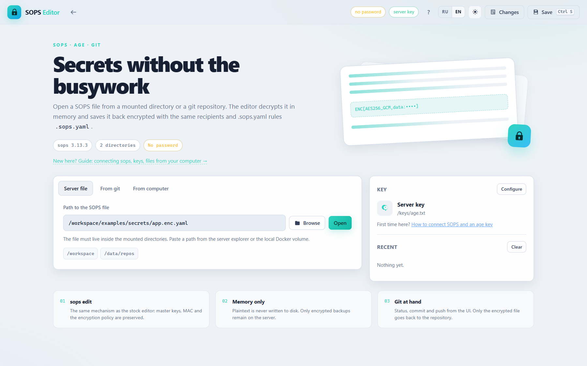
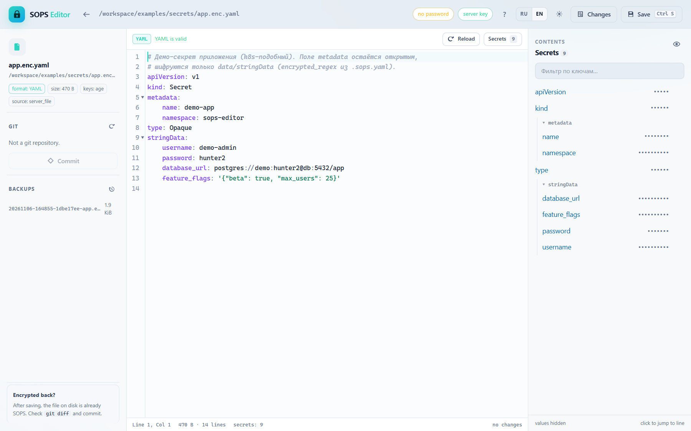
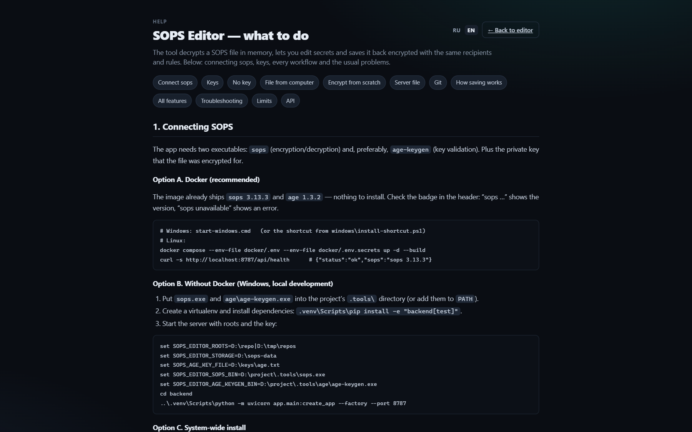
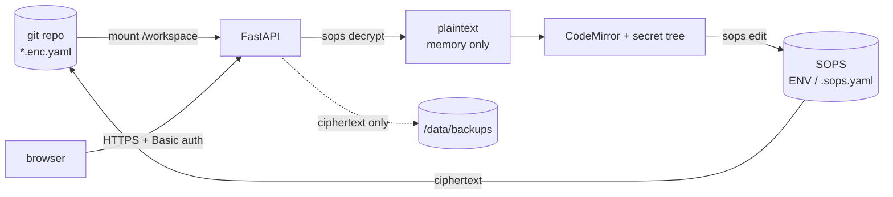

<div align="center">


<h1>SOPS Editor</h1>

A web editor for secrets encrypted with <a href="https://github.com/getsops/sops">SOPS</a>.<br>
Open a file from a git checkout, a cloned repository or your own computer — it is decrypted **in memory**, edited in a real code editor and saved back **encrypted**, with the same recipients and `.sops.yaml` rules.

<a href="https://github.com/DzmitrySha/sops-editor/actions/workflows/ci.yml"></a>
<a href="LICENSE"></a>
<a href="backend/pyproject.toml"></a>


<sub>English · <a href="README.ru.md">Русская версия</a> · <a href="docs/DEPLOY.md">Deployment</a> · <a href="SECURITY.md">Security</a></sub>

</div>

---

| Dark | Light |
|---|---|
|  |  |
|  |  |

## Contents

- [Highlights](#highlights)
- [How it works](#how-it-works)
- [Quick start](#quick-start)
- [Try it with the demo files](#try-it-with-the-demo-files)
- [Files from your computer](#files-from-your-computer)
- [Keys](#keys)
- [How saving works](#how-saving-works)
- [Git](#git)
- [Deploy on a server behind Traefik](#deploy-on-a-server-behind-traefik)
- [Configuration](#configuration)
- [HTTP API](#http-api)
- [Development and tests](#development-and-tests)
- [Project structure](#project-structure)
- [Roadmap](#roadmap)
- [License](#license)

## Highlights

| | |
|---|---|
| **SOPS-native saving** | Saving goes through `sops edit`: master keys, MAC, `encrypted_regex` and every other rule of the *original* file are preserved. The tool never "re-encrypts with different recipients". |
| **Plaintext in memory only** | Decrypt happens in the process and in the browser. Backups and uploads are ciphertext; the temporary payload for `sops edit` is a `0600` file that is removed in `finally`. |
| **Verified writes** | Before saving, the file's SHA-256 is compared with what the browser saw (protection against clobbering someone else's edit). After saving, the result is decrypted again and compared with the submitted data; on mismatch the original is restored. |
| **Plain files too** | A plain YAML / JSON / dotenv / INI file opens without a key; the **Encrypt** button creates a SOPS version — with `.sops.yaml`, an explicit age recipient or the server key. |
| **Real editor** | CodeMirror with YAML/JSON highlighting, search, folding, `Ctrl+S`, live syntax validation and a masked secret tree that jumps to a line. |
| **Keys, three ways** | Server key file, environment/`SOPS_AGE_KEY`, or a key pasted in the UI (process memory only, TTL 8 h, bound to the tab cookie). Missing key? The dialog shows the recipients from the file metadata. |
| **Visible progress** | Opening, uploading and saving show the real phases (path check, SOPS metadata, `sops decrypt`, format detection, git) with an elapsed timer — no dead spinners. |
| **Git built in** | Branch/file status, committing only the current file, push, `pull --ff-only`, clone from a URL into `/data/repos`. |
| **Bilingual** | RU/EN switch in the header; the documentation follows the language and the theme. |
| **One container** | FastAPI serves the API and the static UI. No nginx, no build step, no Node on the server. |

## How it works



The browser never receives the private key: it sends the path (or the ciphertext),
the server decrypts with `sops`, and the plaintext travels only over the
authenticated HTTPS connection to a single tab.

## Quick start

### Windows (Docker Desktop)

1. Install and start Docker Desktop.
2. Run `start-windows.cmd` — it asks for the directory with SOPS files, builds the
   image and opens `http://localhost:8787`.
   A shortcut can be created with `windows\install-shortcut.ps1`.
3. Optional: put the age key into `keys/age.txt`, or paste it in the UI later.
   Stop with `stop-windows.cmd`.

### Linux / macOS (Docker Compose)

```bash
git clone https://github.com/DzmitrySha/sops-editor.git
cd sops-editor
cp docker/.env.example docker/.env
cp docker/.env.secrets.example docker/.env.secrets
# docker/.env: SOPS_EDITOR_WORKSPACE=/path/to/repo
docker compose --env-file docker/.env --env-file docker/.env.secrets up -d --build
# http://localhost:8787
```

The host directory is mounted as `/workspace`; paths in the UI are container
paths, e.g. `/workspace/secrets/app.enc.yaml`.

> By default the port listens on `127.0.0.1` only and Basic auth is disabled.
> That is acceptable on localhost only — for a server see
> [deployment](docs/DEPLOY.md).

<details>
<summary>If <code>docker compose … up --build</code> fails with <code>failed to execute bake</code></summary>

Some Compose builds cannot use Bake. Build directly, then start:

```bash
docker build -t ai-sops-edit:local .
docker compose --env-file docker/.env --env-file docker/.env.secrets up -d
```

`start-windows.cmd` already contains this fallback.
</details>

## Try it with the demo files

The repository ships ready-made examples: a Kubernetes-style secret, nested YAML,
JSON, dotenv and INI, plus plaintext twins for the "encrypt from scratch" flow.

```bash
cp keys/age.example.txt keys/age.txt     # demo key, Windows: copy keys\age.example.txt keys\age.txt
```

Then open `/workspace/examples/secrets/app.enc.yaml` in the **Server file** tab, or
upload `workspace/examples/plain/config.json` in the **From computer** tab and
press **Encrypt**.

> `keys/age.example.txt` is public on purpose: it only protects the example files.
> Never use it for real secrets.

## Files from your computer

1. Open the **From computer** tab and press **Choose file** (the standard browser
   dialog) or drop a file onto the zone. A status line shows the name, size and
   progress; a plain YAML/JSON/dotenv/INI opens as well.
2. No server key? The **Key** dialog appears — paste `AGE-SECRET-KEY-1…`; it is
   kept in process memory and the file opens right after.
3. Edit, then **Save**.
4. **Download encrypted** in the left panel and replace the file in your project,
   or — in Chrome/Edge — **Write to source file**, which writes through the File
   System Access API and only asks for overwrite confirmation. Press
   **Allow overwriting the file…** once if the plain dialog was used.

> Browsers do not expose the full local path. The tool works with the chosen file;
> to work with a whole repository, mount it as `/workspace`.

## Keys

| Source | How to set | Notes |
|---|---|---|
| Server file | `keys/age.txt` → `/keys/age.txt` | `chmod 600`, owned by the container user (root by default) |
| Environment | `SOPS_AGE_KEY` / `SOPS_AGE_KEY_FILE` | PGP/KMS use their usual variables and credentials |
| UI session | **Key** button → paste `AGE-SECRET-KEY-1…` | process memory, TTL 8 h, bound to the tab cookie |

```bash
age-keygen -o age.txt
grep 'public key' age.txt   # add this recipient to .sops.yaml
```

The recipient must already be in the repository's `.sops.yaml`: the tool never
changes recipients. Without the matching private key decryption is impossible —
the dialog shows which recipients the file expects, and the in-app guide has a
"No key" section on where to look for age/PGP/KMS keys.

## How saving works

1. The server reads the current ciphertext and compares its SHA-256 with what the
   browser saw (protects against overwriting a concurrent edit).
2. Writes a ciphertext backup to `/data/backups/<hash>/`.
3. Puts the submitted plaintext into a `0600` file inside a private `0700` directory.
4. Runs `sops edit <file>`: SOPS decrypts the original, calls the one-shot editor,
   re-encrypts **with the original metadata** and updates the MAC/`lastmodified`.
5. Decrypts the result and compares the data with what was submitted; on error the
   original ciphertext is restored atomically.
6. Deletes the temporary plaintext in `finally`.

At any moment the file on disk is either the old or the new ciphertext.

## Git

- **Commit** — `git add -- <file>` + `git commit -- <file>`; only the current file.
- **Push** — `git push`; for HTTPS set `SOPS_EDITOR_GIT_TOKEN` (GitLab `oauth2`,
  GitHub `x-access-token`), for SSH mount a key/agent.
- **Clone** — URL + branch into `/data/repos/<name>`; the token never comes from the UI.
- **Pull** — `--ff-only`, only with a clean worktree.

## Deploy on a server behind Traefik

```bash
cp docker/.env.example docker/.env
cp docker/.env.secrets.example docker/.env.secrets
# docker/.env:
#   SOPS_EDITOR_WORKSPACE=/srv/git/secrets
#   SOPS_EDITOR_FQDN=sops.example.com
#   SOPS_EDITOR_TRUST_PROXY=true
#   SOPS_EDITOR_COOKIE_SECURE=true
# docker/.env.secrets:
#   SOPS_EDITOR_AUTH_PASSWORD=<long random password>

docker compose -f docker-compose.yml -f docker-compose.traefik.yml \
  --env-file docker/.env --env-file docker/.env.secrets up -d --build
```

An external `traefik_proxy` network is required. Details:
[docs/DEPLOY.md](docs/DEPLOY.md) · [SECURITY.md](SECURITY.md) ·
[Русская версия](docs/ru/DEPLOY.md).

## Configuration

All settings are environment variables with the `SOPS_EDITOR_` prefix (plus the
standard `SOPS_AGE_KEY_FILE` / `SOPS_AGE_KEY`):

| Variable | Default | Purpose |
|---|---|---|
| `SOPS_EDITOR_ROOTS` | `/workspace\|/data/repos` | allowed roots, `\|` or `os.pathsep` |
| `SOPS_EDITOR_STORAGE` | `/data` | backups, uploads, cloned repositories, logs |
| `SOPS_AGE_KEY_FILE` | `/keys/age.txt` (if present) | private age key |
| `SOPS_EDITOR_AUTH_USER` / `_PASSWORD` | `sops` / empty | HTTP Basic auth |
| `SOPS_EDITOR_MAX_FILE_BYTES` | `5242880` | file size limit |
| `SOPS_EDITOR_BACKUP_KEEP` | `10` | ciphertext copies per file |
| `SOPS_EDITOR_SESSION_TTL_SECONDS` | `28800` | UI key TTL |
| `SOPS_EDITOR_ALLOW_GIT_CLONE` | `true` | allow cloning |
| `SOPS_EDITOR_GIT_ALLOWED_HOSTS` | empty | clone host allowlist |
| `SOPS_EDITOR_GIT_TOKEN` | empty | HTTPS git token |
| `SOPS_EDITOR_TRUST_PROXY` / `_COOKIE_SECURE` | `false` | behind a reverse proxy |
| `SOPS_EDITOR_LOG_LEVEL` | `INFO` | loguru level |

## HTTP API

| Method | Path | Purpose |
|---|---|---|
| GET | `/api/health` | health, sops version |
| GET | `/api/status` | roots, auth, key source |
| GET | `/api/browse?path=` | directory listing |
| GET | `/api/search?q=&path=` | search files |
| GET | `/api/file?path=` | decrypt and open (plain files too) |
| POST | `/api/file` | encrypt/save |
| GET/POST | `/api/file/job?op=` | same, with a progress operation id |
| GET | `/api/ops/{id}` | operation status, events, result |
| POST | `/api/upload?name=&op=` | upload from the computer (raw body) |
| POST | `/api/encrypt/upload?name=&recipients=` | encrypt a plain uploaded file |
| POST | `/api/encrypt` | encrypt a plain server file |
| GET | `/api/download?path=` | download an uploaded file |
| GET | `/api/backups?path=` | list backups |
| GET | `/api/backups/{id}?path=` | download a backup |
| POST / DELETE | `/api/session/key` | set / forget the tab age key |
| GET | `/api/git?path=` | git status |
| POST | `/api/git/commit` · `/push` · `/pull` · `/clone` | git actions |

The interactive documentation follows the app language: `?lang=en` on
`/help.html`.

## Development and tests

```bash
python -m venv .venv
.venv/Scripts/pip install -e "backend[test]"      # Windows
# .venv/bin/pip install -e "backend[test]"        # Linux / macOS

cd backend
../.venv/Scripts/python -m pytest -q              # 32 tests
../.venv/Scripts/python -m ruff check app tests
```

The tests run against real `sops` and `age-keygen`. On Windows put the binaries
into `.tools/` (`sops.exe`, `age/age-keygen.exe`) or add them to `PATH`; the Docker
image already ships them. Tests that need the binaries are skipped otherwise.

Run without Docker:

```bash
cd backend
SOPS_EDITOR_ROOTS="D:/repo|D:/tmp/repos" SOPS_AGE_KEY_FILE="D:/keys/age.txt" \
  ../.venv/Scripts/python -m uvicorn app.main:create_app --factory --port 8787
```

The frontend is plain static files — no build step. Edit `frontend/*.js|css|html`
and reload the page.

## Project structure

```text
backend/app/        FastAPI: sops, files, git, sessions, security
backend/tests/      pytest against real sops
frontend/           static UI (vendored CodeMirror), help.html + help.en.html, i18n.js
docker/             environment examples
docker-compose*.yml local / Traefik / offline overlays
start-windows.cmd   Windows launcher
windows/            shortcut installer
docs/               deployment, security, screenshots (ru/ for Russian)
```

## Roadmap

- [x] Plaintext files and "encrypt from scratch"
- [x] Real progress instead of buffered responses
- [x] RU/EN interface and documentation
- [ ] Key rotation helper (`sops updatekeys` / `rotate`) from the UI
- [ ] Git diff view with decrypted values side by side
- [ ] Optional OIDC in front of Basic auth

## Limits

- No **binary** SOPS files (YAML / JSON / dotenv / INI only).
- No recipient/KMS management: the policy comes from the file and `.sops.yaml`;
  use `sops updatekeys` / `sops rotate` for rotation.
- No multi-user model: Basic auth, one server key or per-session keys.
- Image build needs internet (sops/age/pip); offline builds are not included.
- The browser cannot write an arbitrary path — only a file whose handle it holds
  (Chrome/Edge), otherwise download.

## Contributing

Issues and pull requests are welcome — see [CONTRIBUTING.md](CONTRIBUTING.md).
For vulnerabilities please use [private reporting](SECURITY.md), not a public issue.

## License

[MIT](LICENSE) © 2026 Dzmitry.

<div align="center">
<sub>If this tool saves you time, a ⭐ helps others find it.</sub>
</div>

<a href="https://star-history.com/#DzmitrySha/sops-editor&Date">
  
</a>
